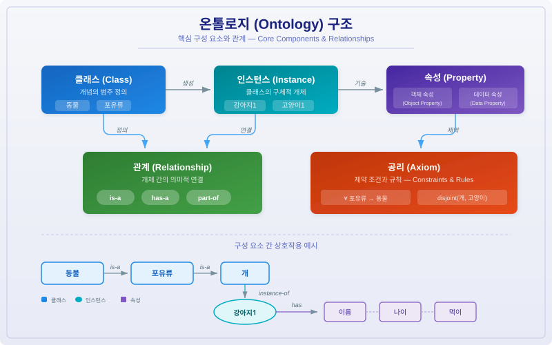
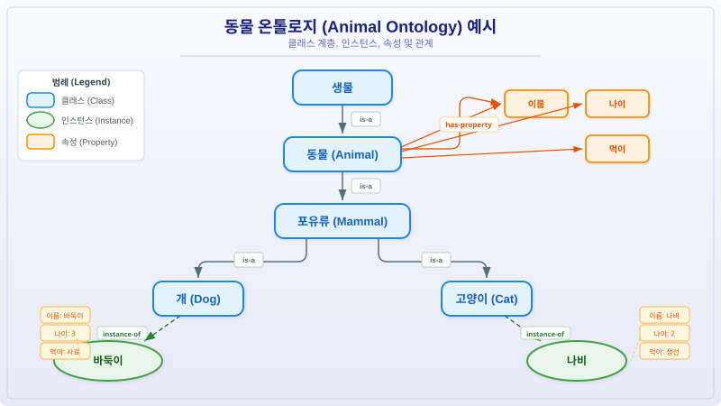
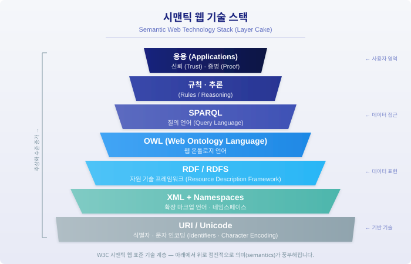

## 목차

1. [정의](#1-정의)
2. [사용 목적](#2-사용-목적)
3. [구성 요소](#3-구성-요소)
4. [기술적 장단점](#4-기술적-장단점)
5. [관련 라이브러리 및 오픈소스](#5-관련-라이브러리-및-오픈소스)
6. [활용 예시](#6-활용-예시)
7. [연관 기술](#7-연관-기술)
8. [결론](#8-결론)
9. [참고문헌](#9-참고문헌)

---

## 1. 정의

**온톨로지(Ontology)**는 특정 도메인 내의 개념(Concept), 개체(Entity), 속성(Property), 그리고 이들 간의 관계(Relationship)를 **형식적(Formal)**이고 **명시적(Explicit)**으로 정의한 지식 표현 체계이다.

원래 철학에서 "존재론"을 의미하는 용어였으나, 컴퓨터 과학에서는 **"공유된 개념화의 형식적이고 명시적인 명세(A formal, explicit specification of a shared conceptualization)"**로 정의된다 (Gruber, 1993; Studer et al., 1998). 즉, 특정 분야의 지식을 컴퓨터가 이해하고 추론할 수 있는 형태로 구조화한 것이다.

온톨로지는 단순한 데이터 모델이나 데이터베이스 스키마와 달리, **논리적 추론(Logical Reasoning)**이 가능한 형식 의미론(Formal Semantics)을 갖추고 있어, 명시적으로 기술되지 않은 새로운 지식을 자동으로 도출할 수 있다는 점에서 차별화된다.

---

## 2. 사용 목적

### 2.1 지식의 공유와 재사용

온톨로지의 가장 근본적인 목적은 특정 도메인의 지식을 **표준화된 형식**으로 정의하여, 서로 다른 시스템·조직·사람 간에 **공통된 이해(Shared Understanding)**를 형성하는 것이다. 동일한 온톨로지를 사용하면 서로 다른 애플리케이션이 같은 의미 체계를 공유할 수 있다.

### 2.2 시맨틱 상호운용성

이기종 시스템 간의 데이터 통합 시, 온톨로지는 **의미적 매핑(Semantic Mapping)**의 기반이 된다. 예를 들어, 시스템 A에서 "고객"이라 부르는 개념과 시스템 B에서 "사용자"라 부르는 개념이 동일한 온톨로지 클래스에 매핑되면, 두 시스템의 데이터를 의미적으로 통합할 수 있다.

### 2.3 자동 추론

온톨로지에 정의된 클래스 계층, 속성 제약, 공리 등을 기반으로 **추론 엔진(Reasoner)**이 새로운 사실을 자동으로 도출할 수 있다. 예를 들어, "고래는 포유류이다"와 "포유류는 폐로 호흡한다"가 정의되어 있으면, "고래는 폐로 호흡한다"를 자동으로 추론할 수 있다.

### 2.4 시맨틱 웹 구현

W3C의 시맨틱 웹(Semantic Web) 비전은 웹 상의 데이터에 의미를 부여하여 기계가 이해할 수 있도록 하는 것이며, 온톨로지는 이 비전의 **핵심 기술 계층**에 해당한다.

---

## 3. 구성 요소

온톨로지는 다음과 같은 핵심 구성 요소로 이루어진다.



### 3.1 클래스 (Class)

도메인 내의 **개념(Concept)**을 정의한다. 클래스는 계층 구조(Taxonomy)를 형성하며, 상위 클래스(Superclass)와 하위 클래스(Subclass) 관계를 통해 일반화와 특수화를 표현한다.

```
생물 (Living Thing)
  └── 동물 (Animal)
        ├── 포유류 (Mammal)
        │     ├── 개 (Dog)
        │     └── 고양이 (Cat)
        └── 조류 (Bird)
```

### 3.2 인스턴스 (Instance / Individual)

클래스의 **구체적인 개체**를 나타낸다. 예를 들어, "바둑이"는 "개" 클래스의 인스턴스이다. 인스턴스는 클래스에 정의된 속성 값을 가지며, 실제 데이터를 표현한다.

### 3.3 속성 (Property)

개체의 특성이나 개체 간의 관계를 기술한다. OWL에서는 두 가지 유형으로 구분된다:

| 속성 유형 | 설명 | 예시 |
|-----------|------|------|
| **객체 속성 (Object Property)** | 두 인스턴스 간의 관계를 정의 | `먹는다(바둑이, 사료)` |
| **데이터 속성 (Data Property)** | 인스턴스와 데이터 값 간의 관계를 정의 | `나이(바둑이, 3)` |

### 3.4 관계 (Relationship)

개체 간의 **의미적 연결**을 정의한다. 대표적인 관계 유형은 다음과 같다:

| 관계 유형 | 의미 | 예시 |
|-----------|------|------|
| **is-a (하위 분류)** | 클래스 간 상속 관계 | 개 is-a 포유류 |
| **instance-of** | 인스턴스와 클래스의 소속 관계 | 바둑이 instance-of 개 |
| **part-of (부분-전체)** | 구성 요소 관계 | 엔진 part-of 자동차 |
| **has-a (소유)** | 속성 보유 관계 | 자동차 has-a 바퀴 |

### 3.5 공리 (Axiom)

온톨로지 내에서 항상 참인 **논리적 규칙**을 정의한다. 공리는 추론 엔진이 새로운 지식을 도출하는 데 사용된다.

- **클래스 공리**: `포유류 ⊆ 동물` (모든 포유류는 동물이다)
- **속성 제약**: `has-mother`는 정확히 1개의 값을 가진다 (Cardinality Constraint)
- **분리 공리**: `남성 ⊓ 여성 = ∅` (남성과 여성은 서로소 집합이다)

### 3.6 구성 요소 간 관계 요약

아래 도식은 동물 도메인을 예시로 한 온톨로지의 구체적인 구성을 보여준다.



---

## 4. 기술적 장단점

### 4.1 장점

| 항목 | 설명 |
|------|------|
| **형식적 의미론** | 수학적·논리적 기반을 갖추어 모호성 없이 지식을 표현하며, 기계가 정확하게 해석 가능 |
| **자동 추론** | 추론 엔진을 통해 명시되지 않은 새로운 사실을 자동으로 도출 가능 |
| **지식 재사용** | 한 번 정의된 온톨로지를 여러 시스템에서 공유·재사용 가능하여 개발 비용 절감 |
| **상호운용성** | 이기종 시스템 간 데이터 통합의 의미적 기반을 제공 |
| **일관성 검증** | 추론 엔진이 온톨로지 내의 논리적 모순을 자동으로 탐지 |
| **표준화** | W3C 표준(RDF, OWL, SPARQL)에 기반하여 광범위한 도구 생태계 활용 가능 |
| **확장성** | 기존 온톨로지를 상속·확장하여 새로운 도메인에 적용 가능 |

### 4.2 단점

| 항목 | 설명 |
|------|------|
| **높은 구축 비용** | 도메인 전문가와 온톨로지 엔지니어의 협업이 필요하며, 구축에 상당한 시간과 비용이 소요됨 |
| **유지보수 어려움** | 도메인 지식이 변화하면 온톨로지도 갱신해야 하며, 대규모 온톨로지의 유지보수는 복잡함 |
| **추론 성능 한계** | OWL DL 이상의 표현력을 가진 온톨로지에서 추론은 계산 복잡도가 높아 대규모 데이터에서 성능 저하 가능 |
| **학습 곡선** | RDF, OWL, SPARQL 등의 기술 스택을 이해하는 데 상당한 학습이 필요 |
| **과잉 설계 위험** | 단순한 데이터 모델링에 온톨로지를 적용하면 불필요한 복잡성이 발생할 수 있음 |
| **합의 도출 어려움** | 도메인 전문가 간 개념 정의에 대한 합의를 이끌어내는 것이 어려울 수 있음 |

---

## 5. 관련 라이브러리 및 오픈소스

### 5.1 Protégé

- **웹사이트**: [https://protege.stanford.edu/](https://protege.stanford.edu/)
- **개발**: Stanford University
- **설명**: 가장 널리 사용되는 오픈소스 온톨로지 편집기. OWL 온톨로지의 생성, 편집, 시각화를 지원하며, 다양한 추론 엔진 플러그인을 제공한다. 데스크톱 버전과 웹 버전(WebProtégé)이 있다.
- **특징**: 직관적인 GUI, 풍부한 플러그인 생태계, OWL 2 완전 지원.

### 5.2 Apache Jena

- **GitHub**: [https://github.com/apache/jena](https://github.com/apache/jena)
- **Stars**: 1,200+
- **설명**: Java 기반의 시맨틱 웹 프레임워크. RDF 데이터 처리, SPARQL 쿼리 실행, OWL 추론을 지원한다. TDB(트리플 스토어)와 Fuseki(SPARQL 서버)를 포함한다.
- **특징**: 산업 표준 수준의 안정성, 대규모 RDF 데이터 처리, 다양한 추론 엔진 통합.

### 5.3 RDFLib

- **GitHub**: [https://github.com/RDFLib/rdflib](https://github.com/RDFLib/rdflib)
- **Stars**: 2,200+
- **설명**: Python 기반의 RDF 처리 라이브러리. RDF 그래프의 생성, 파싱, 직렬화, SPARQL 쿼리를 지원한다. Python 생태계에서 시맨틱 웹 작업의 사실상 표준이다.
- **특징**: 순수 Python 구현, 다양한 RDF 직렬화 포맷 지원, SPARQL 1.1 지원.

### 5.4 OWL API

- **GitHub**: [https://github.com/owlcs/owlapi](https://github.com/owlcs/owlapi)
- **Stars**: 1,000+
- **설명**: Java 기반의 OWL 온톨로지 처리 API. OWL 2 명세를 완전히 지원하며, Protégé의 핵심 라이브러리로 사용된다. HermiT, Pellet 등의 추론 엔진과 통합된다.
- **특징**: OWL 2 완전 지원, 다양한 온톨로지 포맷 호환, 프로그래밍 방식의 온톨로지 조작.

### 5.5 Owlready2

- **GitHub**: [https://github.com/pwin/owlready2](https://github.com/pwin/owlready2)
- **Stars**: 1,000+
- **설명**: Python에서 OWL 온톨로지를 객체지향 방식으로 다룰 수 있는 라이브러리. 온톨로지의 클래스를 Python 클래스처럼 사용할 수 있으며, HermiT 추론 엔진을 내장하고 있다.
- **특징**: Pythonic API, 자동 추론 지원, SQLite 기반 로컬 저장소.

### 5.6 주요 추론 엔진

| 추론 엔진 | 언어 | 특징 |
|-----------|------|------|
| **HermiT** | Java | OWL 2 DL 완전 지원, Tableau 기반 추론 |
| **Pellet (Openllet)** | Java | OWL 2 DL 지원, SPARQL-DL 쿼리, 설명 생성 |
| **FaCT++** | C++ | 고성능 DL 추론, OWL 2 DL 지원 |
| **ELK** | Java | OWL 2 EL 프로파일 특화, 대규모 온톨로지에 최적화 |

---

## 6. 활용 예시

### 6.1 의료·생명과학

온톨로지가 가장 활발하게 활용되는 분야이다. **Gene Ontology(GO)**는 유전자 기능을 체계적으로 분류하며, **SNOMED CT**는 30만 개 이상의 의료 개념을 포함하는 대규모 임상 온톨로지이다. 이를 통해 전자건강기록(EHR) 시스템 간 데이터 상호운용성을 확보하고, 임상 의사결정 지원 시스템에서 자동 추론을 수행한다.

### 6.2 지식 그래프

Google Knowledge Graph, Wikidata, DBpedia 등의 대규모 지식 그래프는 온톨로지를 기반으로 구축되었다. 검색 엔진에서 "서울의 인구는?"이라는 질문에 직접 답변할 수 있는 것은 온톨로지 기반의 구조화된 지식 덕분이다.

### 6.3 사물인터넷 (IoT)

**SSN(Semantic Sensor Network) 온톨로지**는 W3C 표준으로, IoT 센서와 관측 데이터를 의미적으로 기술한다. 이기종 IoT 디바이스 간의 데이터 통합과 상황 인식(Context Awareness)에 활용된다.

### 6.4 전자상거래

**GoodRelations 온톨로지**는 제품, 가격, 배송 조건 등의 전자상거래 정보를 구조화한다. Schema.org에 통합되어 검색 엔진이 제품 정보를 이해하고 리치 스니펫(Rich Snippet)으로 표시하는 데 활용된다.

### 6.5 인공지능·자연어 처리

**WordNet**은 영어 단어 간의 의미 관계를 온톨로지로 구성한 어휘 데이터베이스로, 자연어 처리에서 단어 의미 분별(Word Sense Disambiguation), 텍스트 유사도 계산 등에 널리 활용된다.

---

## 7. 연관 기술

### 7.1 시맨틱 웹 기술 스택

온톨로지는 시맨틱 웹 기술 스택의 핵심 계층에 위치한다.



### 7.2 RDF (Resource Description Framework)

온톨로지의 데이터 모델 기반이 되는 W3C 표준이다. 모든 정보를 **주어-술어-목적어(Subject-Predicate-Object)** 형태의 트리플(Triple)로 표현한다. 예: `<바둑이> <종류> <개>`.

### 7.3 OWL (Web Ontology Language)

W3C가 정의한 온톨로지 표현 언어로, RDF/RDFS를 확장하여 더 풍부한 의미 표현과 추론을 지원한다. 표현력에 따라 OWL Lite, OWL DL, OWL Full의 세 가지 하위 언어로 구분된다.

| OWL 프로파일 | 표현력 | 추론 복잡도 | 용도 |
|-------------|--------|------------|------|
| **OWL 2 EL** | 제한적 | 다항 시간 | 대규모 온톨로지 (SNOMED CT 등) |
| **OWL 2 QL** | 제한적 | 다항 시간 | 대규모 데이터 쿼리 |
| **OWL 2 RL** | 중간 | 다항 시간 | 규칙 기반 추론 |
| **OWL 2 DL** | 높음 | 결정 가능 (최악 지수 시간) | 범용 온톨로지 모델링 |

### 7.4 SPARQL

RDF 데이터를 질의하기 위한 W3C 표준 쿼리 언어이다. SQL과 유사한 구문으로 트리플 패턴 매칭을 수행한다.

```sparql
SELECT ?동물 ?이름
WHERE {
  ?동물 rdf:type :포유류 .
  ?동물 :이름 ?이름 .
  ?동물 :서식지 :한국 .
}
```

### 7.5 지식 그래프 (Knowledge Graph)

온톨로지를 스키마(Schema)로 사용하여 대규모 구조화된 지식을 그래프 형태로 저장·관리하는 기술이다. 온톨로지가 "개념의 정의"를 담당한다면, 지식 그래프는 "실제 데이터"를 담당한다.

### 7.6 GraphRAG

최근 주목받는 기술로, 지식 그래프와 RAG(Retrieval-Augmented Generation)를 결합한 방식이다. 온톨로지 기반의 지식 그래프를 활용하여 LLM의 응답 품질을 향상시키며, 특히 전역적 질의와 다중 홉 추론에서 강점을 보인다.

### 7.7 기술 비교

| 기술 | 목적 | 구조화 수준 | 추론 가능 여부 |
|------|------|------------|---------------|
| **데이터베이스 스키마** | 데이터 저장 구조 정의 | 높음 | 제한적 (SQL 제약) |
| **택소노미 (Taxonomy)** | 분류 체계 정의 | 중간 | 불가 |
| **시소러스 (Thesaurus)** | 용어 간 관계 정의 | 중간 | 불가 |
| **온톨로지 (Ontology)** | 도메인 지식의 형식적 명세 | 매우 높음 | 가능 (추론 엔진) |
| **지식 그래프** | 대규모 구조화 지식 저장 | 높음 | 온톨로지 기반 시 가능 |

---

## 8. 결론

온톨로지는 **지식을 형식적으로 표현하고 기계가 이해·추론할 수 있도록 하는 핵심 기술**로, 시맨틱 웹의 비전을 실현하는 근간이다.

의료·생명과학 분야에서 Gene Ontology, SNOMED CT 등이 실제 산업에서 광범위하게 활용되고 있으며, Google Knowledge Graph, Wikidata 등 대규모 지식 그래프의 스키마 계층으로서 웹 검색과 AI 시스템의 지능을 뒷받침하고 있다.

최근에는 **LLM(대규모 언어 모델)**과의 결합이 새로운 연구 방향으로 부상하고 있다. LLM을 활용한 온톨로지 자동 구축, 온톨로지 기반 프롬프트 엔지니어링, GraphRAG에서의 온톨로지 활용 등이 활발히 연구되고 있다. 특히 LLM이 생성하는 응답의 **사실 정확성(Factual Accuracy)**과 **일관성(Consistency)**을 온톨로지 기반 검증으로 향상시키려는 시도가 주목받고 있다.

다만, 온톨로지 구축의 높은 비용과 유지보수의 어려움은 여전히 과제로 남아 있다. 이를 해결하기 위해 자동·반자동 온톨로지 학습(Ontology Learning) 기술과 LLM 기반 온톨로지 엔지니어링 도구의 발전이 기대된다.

온톨로지는 단순한 데이터 모델링 도구를 넘어, **AI 시스템이 세계를 이해하는 방식의 기반**이 되는 기술이다. 데이터의 양이 폭발적으로 증가하고 AI 시스템의 지능이 고도화되는 시대에, 지식의 구조적 표현과 의미적 추론을 가능하게 하는 온톨로지의 중요성은 더욱 커질 것이다.

---

## 9. 참고문헌

1. Thomas R. Gruber. "A Translation Approach to Portable Ontology Specifications." *Knowledge Acquisition*, 5(2), 199-220, 1993. [https://doi.org/10.1006/knac.1993.1008](https://doi.org/10.1006/knac.1993.1008)

2. Rudi Studer, V. Richard Benjamins, Dieter Fensel. "Knowledge Engineering: Principles and Methods." *Data & Knowledge Engineering*, 25(1-2), 161-197, 1998. [https://doi.org/10.1016/S0169-023X(97)00056-6](https://doi.org/10.1016/S0169-023X(97)00056-6)

3. Natalya F. Noy, Deborah L. McGuinness. "Ontology Development 101: A Guide to Creating Your First Ontology." Stanford Knowledge Systems Laboratory Technical Report KSL-01-05, 2001. [https://protege.stanford.edu/publications/ontology_development/ontology101.pdf](https://protege.stanford.edu/publications/ontology_development/ontology101.pdf)

4. W3C. "OWL 2 Web Ontology Language Document Overview (Second Edition)." W3C Recommendation, 2012. [https://www.w3.org/TR/owl2-overview/](https://www.w3.org/TR/owl2-overview/)

5. W3C. "RDF 1.1 Concepts and Abstract Syntax." W3C Recommendation, 2014. [https://www.w3.org/TR/rdf11-concepts/](https://www.w3.org/TR/rdf11-concepts/)

6. W3C. "SPARQL 1.1 Query Language." W3C Recommendation, 2013. [https://www.w3.org/TR/sparql11-query/](https://www.w3.org/TR/sparql11-query/)

7. The Gene Ontology Consortium. "The Gene Ontology Resource: enriching a GOld mine." *Nucleic Acids Research*, 49(D1), D331-D338, 2021. [https://doi.org/10.1093/nar/gkaa1113](https://doi.org/10.1093/nar/gkaa1113)

8. SNOMED International. "SNOMED CT." [https://www.snomed.org/](https://www.snomed.org/)

9. Stanford University. "Protégé." [https://protege.stanford.edu/](https://protege.stanford.edu/)

10. Apache Software Foundation. "Apache Jena." [https://jena.apache.org/](https://jena.apache.org/)
